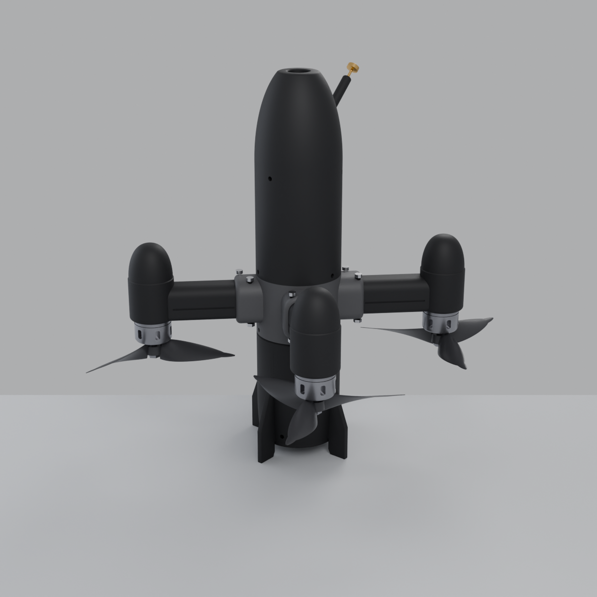
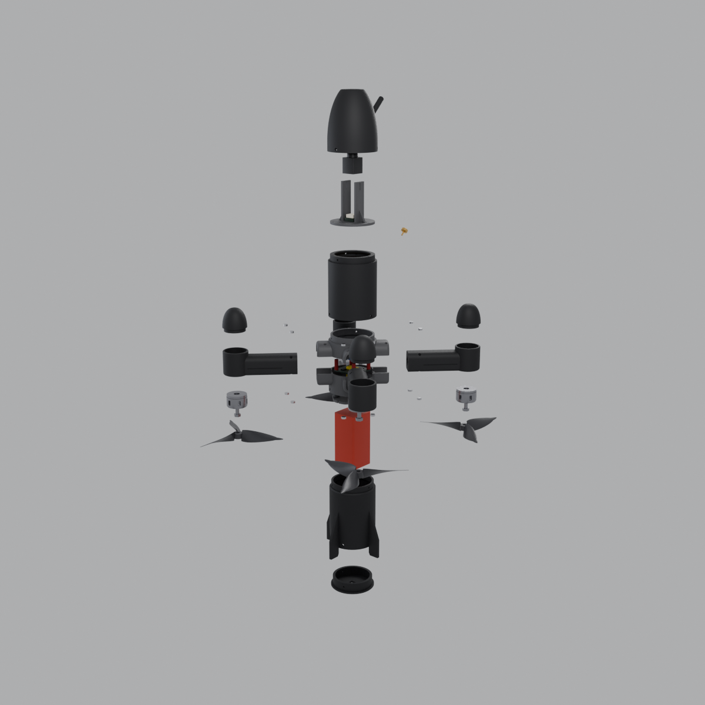
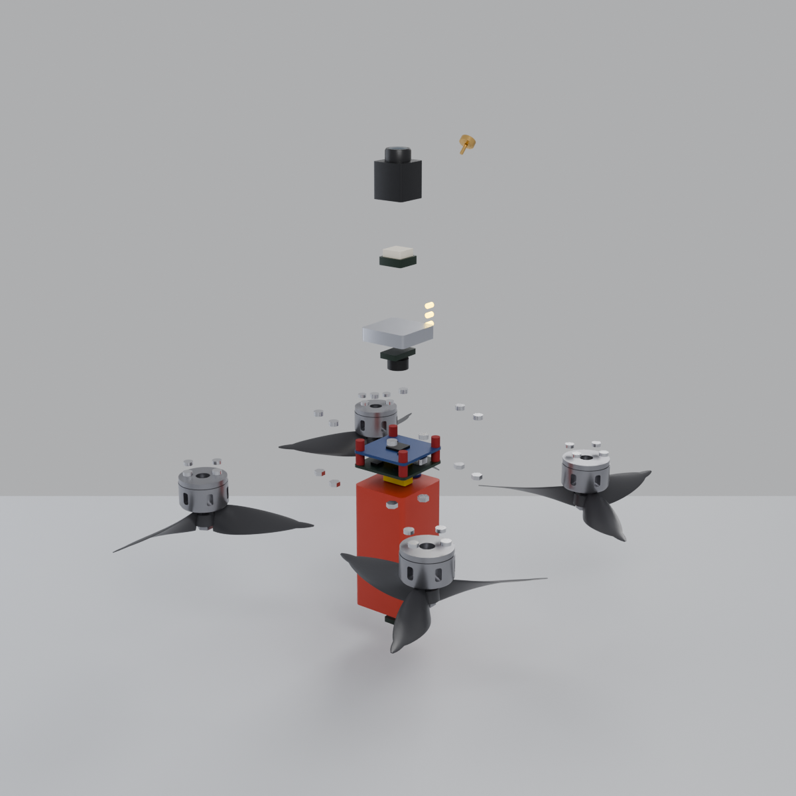
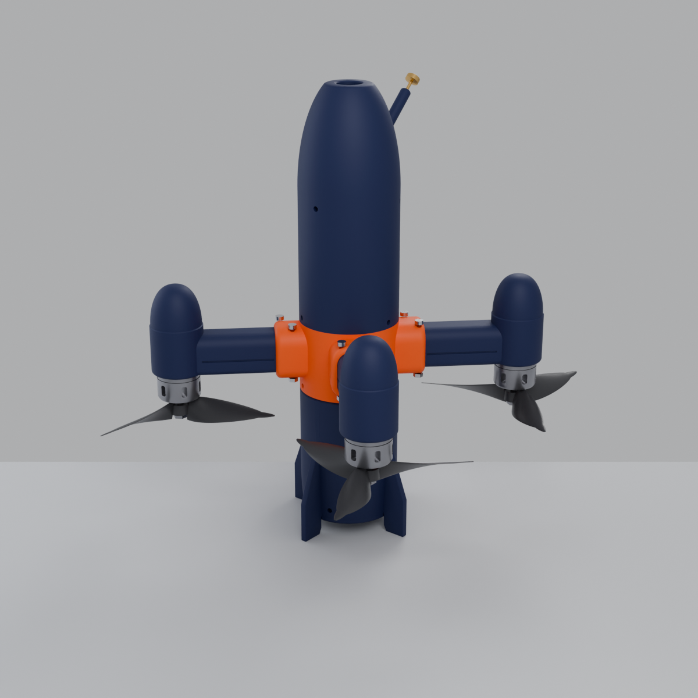

# VECTOR-X: dron de alta velocidad imprimible en 3D

Cuadricóptero de 5" con fuselaje vertical tipo "bala", inspirado en el PIC-SUN Skyfall y el Red Bull Drone:
nariz ojival con la cámara en la punta, 4 brazos en X con góndolas y cúpulas, motores empujadores hacia abajo
y 4 aletas de cola que hacen de tren de aterrizaje. El modelo es **paramétrico** (Blender + Python), todas las
piezas salen cerradas (0 bordes no-manifold) y se comprobó que **ninguna pieza ni componente se solapa** en el
ensamblaje.



| Explosionada | Electrónica interna | Variante "Racing" |
|---|---|---|
|  |  |  |

## Contenido

| Ruta | Qué es |
|---|---|
| `generar_dron.py` | Generador paramétrico. Todas las cotas están al inicio del archivo. |
| `dron_vector_x.blend` | Ensamblaje completo en Blender: piezas, electrónica de referencia y vista explosionada. |
| `stl/` | Piezas imprimibles en mm, ya orientadas para imprimir sin soportes. `stl/INFORME_PIEZAS.md` trae tamaños y volúmenes. |
| `web/*.glb` | Modelo ensamblado y explosionado, para visores web, AR o para importar en otro CAD. |
| `renders/` | Imágenes renderizadas con Cycles. |

### Regenerar o modificar

```bash
# Con Blender instalado
blender -b -P generar_dron.py -- --render
# O con el módulo de Python (pip install bpy, Python 3.11)
python generar_dron.py --render        # --no-export solo construye y valida
```

También se puede abrir `generar_dron.py` en el editor de texto de Blender y pulsar *Run Script*.
Los parámetros más útiles son `R_BODY` (radio del fuselaje), `WALL` (espesor de pared), `ARM_R` (distancia del eje
al motor), `CLR` (holgura de encaje) y las alturas `Z_*` de cada unión.

## Especificaciones

| | |
|---|---|
| Altura total | 291 mm (aleta a punta de nariz) |
| Fuselaje | Ø64 mm, pared de 2,4 mm |
| Distancia entre motores | 220 mm en diagonal (clase 5") |
| Hélices | 5" tripala (5,1×5×3), separación entre discos 25 mm, 13 mm al fuselaje |
| Plástico | ~467 cm³ macizos, unos 330 g impresos con 3 perímetros y 20 % de relleno |
| Peso al despegue estimado | 780–850 g con batería 6S 1300 mAh |
| Empuje estimado | unos 6 kg (2207 1850 KV en 6S): relación empuje/peso de 7:1 a 8:1 |

## Piezas a imprimir (11 tipos, 17 piezas)

| STL | Cant. | Función | Orientación en la cama |
|---|---|---|---|
| `01_cola_con_aletas` | 1 | Bahía de la batería y 4 aletas/patas | Labio de unión abajo (ya volteada) |
| `02_tapa_cola` | 1 | Tapón inferior con ventana para el sensor ToF y ranura para la cinta de extracción | Brida abajo |
| `03_placa_pila_fc` | 1 | Base de la pila FC+ESC 30,5×30,5 con 4 insertos M3 | Plana |
| `04_buje_inferior` | 1 | Mitad inferior del buje central (alojamientos de los brazos) | Cara de partición abajo |
| `05_buje_superior` | 1 | Mitad superior del buje, con ranura USB-C | Cara de partición abajo |
| `06_brazo_con_gondola` | 4 | Brazo hueco con canal de cables y montaje de motor 16×16 M3 | Base del motor abajo |
| `07_cupula_motor` | 4 | Cúpula aerodinámica de la góndola | Labio abajo |
| `08_cuerpo_superior` | 1 | Bahía de aviónica y ventana de LEDs | De pie |
| `09_placa_avionica` | 1 | Soporte del VTX 20×20 (arriba) y el receptor y buzzer (abajo) | Plana |
| `10_soporte_camara_gps` | 1 | Disco para el GPS más una horquilla para la cámara de 19 mm con colisos de ajuste | Disco abajo |
| `11_nariz_con_mastil` | 1 | Ojiva con ventana de lente y mástil de antena a 45° | De pie, punta arriba |

### Ajustes de impresión recomendados

- **Material:** PETG-CF o ASA-CF para el buje, los brazos y las placas. PETG o ASA normal para el fuselaje. El PLA se ablanda con el calor de motores y ESC, así que no conviene.
- **Boquilla:** 0,4 mm (de acero endurecido si el filamento lleva fibra). Capa de 0,2 mm; 0,12 mm para la nariz y las cúpulas si quieres mejor acabado.
- **Perímetros:** 4 en el buje, los brazos y las placas; 3 en el resto.
- **Relleno:** giroide del 40 % en los brazos y el buje, del 15–20 % en el resto.
- **Soportes:** ninguno. Los voladizos están diseñados a 45° o menos (cono interior de la nariz, chaflanes de los escalones, canal de cables en rombo).
- **Borde (brim):** de 5 mm en la cola, el cuerpo superior y la nariz.
- **Holgura:** los encajes usan 0,2 mm (`CLR`). Si tu impresora aprieta, sube `CLR` a 0,3 y regenera.

## Lista de materiales: electrónica

Los alojamientos están acotados para estas medidas. Los modelos son ejemplos; vale cualquiera con las mismas dimensiones.

| Componente | Especificación / ejemplo | Medidas que importan |
|---|---|---|
| Motores ×4 | 2207, 1750–1950 KV para 6S (p. ej. T-Motor F60 Pro, iFlight Xing2 2207) | Montaje 16×16 M3, campana ≤ Ø28 |
| Hélices ×4 (2 CW + 2 CCW) | 5,1×5×3 tripala (p. ej. HQ 5.1x5x3, Gemfan 51466) | Ø ≤ 5,1", eje M5 |
| Pila FC + ESC | F7 + ESC 4 en 1 de 55–60 A para 6S, 30,5×30,5 | Placas ≤ 37×37 mm, altura de la pila ≤ 18 mm |
| Cámara FPV | Micro de 19×19 mm (digital o analógica) | Lente ≤ Ø14 mm, cuerpo ≤ 21 mm de largo |
| VTX | Digital o analógico, montaje 20×20 | Placa ≤ 30×30 mm |
| Receptor | ExpressLRS 2,4 GHz (p. ej. RadioMaster RP1/RP2) | ≤ 12×20 mm |
| GPS + brújula | M10 mini | ≤ 18×18 mm |
| Sensor de distancia | ToF VL53L1X o MTF-01 (flujo óptico + ToF), mirando hacia abajo | ≤ 12×16 mm |
| Batería | LiPo 6S 1300–1500 mAh, conector XT60 | Sección ≤ 36×38 mm, largo ≤ 78 mm |
| Otros | Condensador 1000 µF 35 V low-ESR, buzzer de 5 V, 3 LED WS2812, antena VTX con u.FL | |
| Sensores en la FC | IMU (p. ej. ICM-42688-P), barómetro (DPS310/BMP280), sensor de corriente en el ESC | |

## Tornillería

| Cant. | Pieza | Dónde |
|---|---|---|
| 8 + 8 | M3×35 cabeza de botón + tuerca nyloc M3 | Fijación de los brazos entre las dos mitades del buje (2 por brazo) |
| 16 | M3×8 (no uses más largos: tocarían el bobinado) | Motores a las góndolas (suelo de 4 mm) |
| 12 | M3×8 cabeza de botón, autorroscante en plástico | Uniones radiales: cola/buje (3), buje/cuerpo (3), cuerpo/nariz (3), tapa de cola (3) |
| 4 + 4 | Inserto térmico M3 (Ø4, L4) + M3×30 | Pila FC/ESC sobre `03_placa_pila_fc`, con gomas antivibración |
| 4 | M2,5×8 autorroscante | Placa de la pila al escalón del buje inferior |
| 3 | M2,5×8 autorroscante | Soporte de cámara/GPS al labio del cuerpo superior |
| 3 + 4 | M2×6 | Placa de aviónica (3) y VTX 20×20 (4) |
| 2 | M2×5 | Laterales de la cámara (colisos para ajustar la altura) |

Las cúpulas de los motores encajan a presión; una gota de cianoacrilato las asegura.

## Montaje

1. **Brazos y motores.** Atornilla cada motor bajo su góndola y pasa los 3 cables por el agujero del suelo y el canal del brazo hasta la raíz. Coloca la cúpula.
2. **Pila.** Funde los 4 insertos M3 en `03_placa_pila_fc`. Monta el ESC y la FC con gomas y tornillos M3×30, con el USB-C hacia +X (lado de la ranura del buje).
3. **Buje.** Atornilla la placa de la pila por debajo al `04_buje_inferior` (M2,5). Encaja la raíz de los 4 brazos en los alojamientos, coloca encima el `05_buje_superior` y aprieta los 8 pernos M3×35. Suelda los motores al ESC dentro del buje.
4. **Cola.** Suelda el XT60 con el condensador, pásalo por el agujero central de la placa y une la cola al buje (3 × M3). Pega el sensor ToF en la tapa, mirando por la ventana.
5. **Aviónica.** Monta el VTX encima de `09_placa_avionica` y el receptor y el buzzer debajo. Baja la placa por el cuerpo superior hasta su escalón y fíjala (3 × M2). Une el cuerpo al buje (3 × M3).
6. **Nariz.** Fija el GPS sobre `10_soporte_camara_gps` y la cámara en la horquilla, con la lente centrada. Atornilla el soporte al labio del cuerpo (3 × M2,5). Pasa el coaxial de la antena por el mástil antes de cerrar la nariz (3 × M3).
7. **Batería.** Entra por abajo: retira la tapa de cola, desliza la batería con una cinta de extracción y vuelve a cerrar.

## Configuración de vuelo (Betaflight / INAV)

- **Disposición:** quad X estándar. Los brazos están a 45° de los bordes de la FC, así que no hace falta girar la placa.
- **Motores invertidos:** las hélices empujan hacia abajo con los motores boca abajo. Comprueba el orden y el sentido de giro en la pestaña *Motores* y ajusta *motor direction is reversed* si hace falta.
- **Cámara:** mira a lo largo del eje del fuselaje, es decir, unos 90° hacia arriba respecto a un quad clásico. Está pensada para vuelo rápido con el fuselaje casi horizontal. Para que el yaw y el roll se sientan naturales, sube `fpv_mix_degrees` (entre 50 y 80) o usa un modo de vuelo con compensación del ángulo de cámara.
- **Centro de gravedad:** queda en el eje por simetría. La batería, baja, da estabilidad en estacionario. Equilibra los pesos de los dos lados si añades accesorios.
- **GPS:** activa el *GPS Rescue*. El sensor ToF ayuda en aterrizajes asistidos con INAV o ArduPilot.

## Seguridad

Un dron de 800 g a más de 150 km/h es peligroso. Haz la primera prueba sin hélices, equilibra las hélices, revisa
que los pernos de los brazos tengan nyloc y vuela solo en zonas autorizadas, cumpliendo la normativa de tu país
(registro de operador y límites de altura y distancia).
